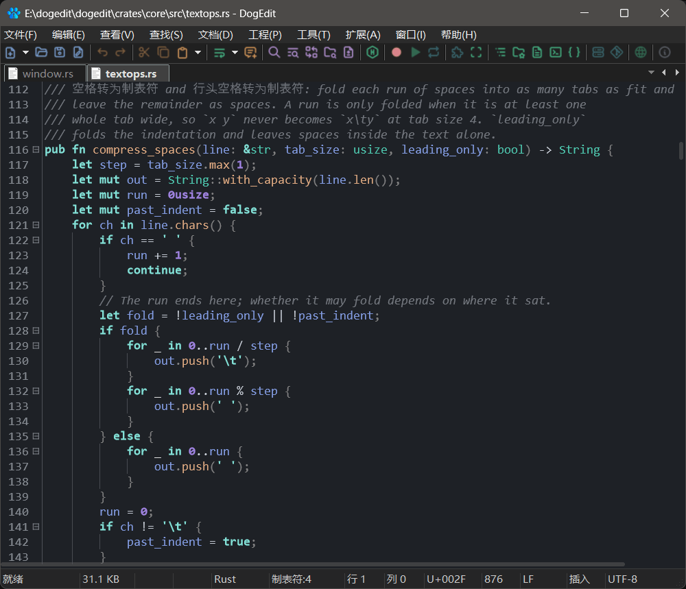
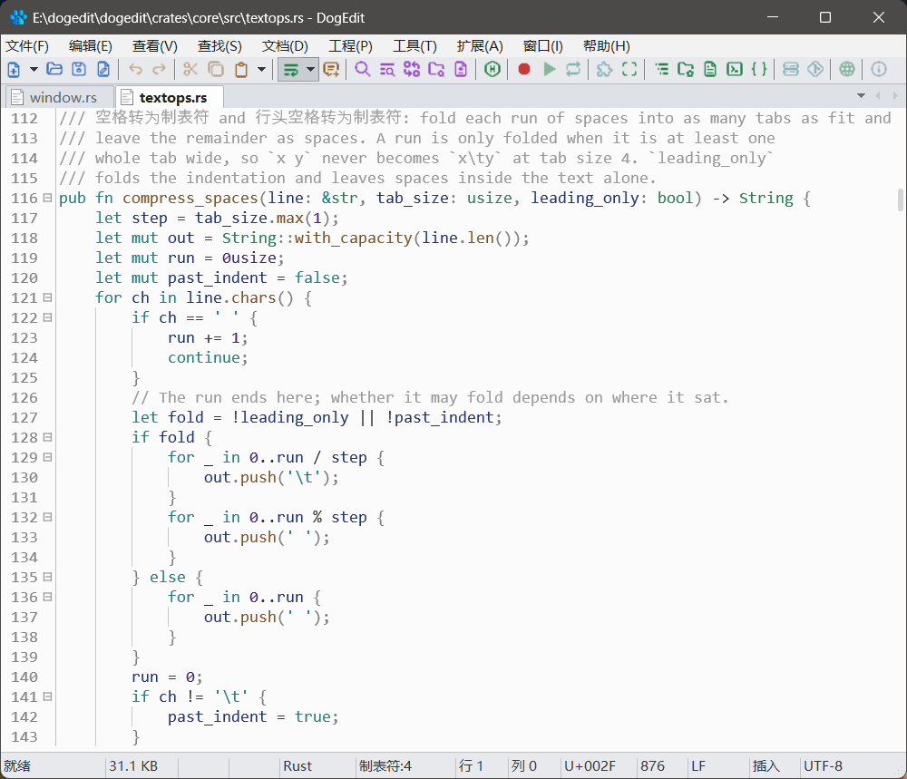

# DogEdit

[简体中文](README.zh-CN.md) · **English**

**A native text editor written in Rust.** 

**27 themes · incremental tree-sitter highlighting · built-in LSP · Lua 5.4 scripting · 0 web runtimes**

<p>
  
  
</p>

## Why it feels different

Plenty of editors ship a web page and call it a window. DogEdit takes the other
road: the message loop, menus, scrollbar and every glyph come from the operating
system. Drag the scrollbar and the text moves — there is nothing to boot first.

Inside, the editor is split cleanly in two. A platform-neutral core owns the
document model, layout, wrapping, syntax, painting, LSP and scripting; a native
shell wires that core to one desktop. **The core doesn't even know a window
exists.** Windows is the shell today — Linux and macOS mean writing a new shell,
not a new editor.

## What you get

- **Highlight only what changed.** tree-sitter colouring is incremental, and
  folding and the outline grow out of the same parse. Language grammars are
  packages you download from inside the editor, so you install what you use and
  skip what you don't.
- **Bring your own language server.** Completion, diagnostics and goto speak
  LSP, with rope-to-LSP positions worked out down to the character.
- **Big files don't make it nervous.** The line index is built on demand, a
  dedicated large-file mode keeps keystrokes responsive, and the hex view has
  its own model for editing bytes.
- **Multi-caret is everyday equipment.** Multiple selections, column mode,
  quick-select, bookmarks, macros and regex search across files — the power-user
  drawer is already open.
- **Change it without recompiling.** Lua 5.4 packages add commands, paint skins,
  drop panels into the dock and hang buttons on the toolbar.
- **27 themes, dark and light.** Colours and per-token style bits — bold,
  italic, underline, strike-through, dotted and wavy — live in plain `.ini`
  files. Edit a line, restart, done.
- **Bytes stay honest.** UTF-8, UTF-16 and ANSI are detected on open; CRLF and
  LF survive the round trip; saving writes back in the encoding the file came in.
- **Panels go where you want them.** Search results, output, bookmarks, outline
  and the file tree are dockable tab groups. Split the window into groups and
  drag tabs between them.

## Bring it home

Grab the [latest release](https://github.com/yoyocat/dogedit/releases/latest) —
a portable zip, no installer. Or build it yourself; the only dependency is a
Rust toolchain (1.85+ / edition 2024). No Node, no extra SDK:

```sh
git clone https://github.com/yoyocat/dogedit.git
cd dogedit
cargo build --workspace
cargo run -p dg-app
cargo run -p dg-app -- --selftest   # headless smoke test
cargo test --workspace
```

The binary lands at `target/debug/dogedit.exe`. Today's build runs on Windows
10/11; Linux and macOS are the next shells on the list.

To assemble the portable zip yourself (`dist/dogedit-<version>-x64.zip` plus a
`.sha256`), from the release binary and the data files it expects next to the
exe — `setting.ini`, `key.ini`, `template.ini` + `template/`, `lang/`,
`themes/`, `packages/` and the licence texts:

```sh
python tools/make_dist.py                 # data files only
python tools/make_dist.py --parsers all  # also bundle the full parsers/ tree
```

Parser packages are left out by default because they are the bulk of the zip;
the editor can fetch them on demand.

## One editor, thirteen crates

| Directory | Package | Job |
|---|---|---|
| `crates/app` | `dg-app` | Native shell: frame, dialogs, input, docking, toolbars |
| `crates/core` | `dg-core` | Document store (rope + line cache), selection, undo, folding, search |
| `crates/layout` | `dg-layout` | Text measurement, wrap engine, vertical row index |
| `crates/syntax` | `dg-syntax` | tree-sitter registry, incremental highlight runs, folding spans |
| `crates/lsp` | `dg-lsp` | LSP client and rope-to-LSP position mapping |
| `crates/render` | `dg-render` | Paint pipeline, themes, minimap, ruler |
| `crates/ui` | `dg-ui` | Status bar model, menus, scrollbar, panels |
| `crates/skin` | `dg-skin` | Shared vocabulary for regions, states, fonts and paint primitives |
| `crates/paint` | `dg-paint` | Style bits and highlight spans shared by the syntax and render layers |
| `crates/hex` | `dg-hex` | Hex view model |
| `crates/large` | `dg-large` | Large-file line index |
| `crates/script` | `dg-script` | Lua scripting and script packages |
| `crates/fixture-json-dll` | `fixture-json-dll` | Test-only parser fixture |

Directory names drop the `dg-` prefix; package names keep it, since a bare
`core` would collide with the standard library crate.

## What's committed, and why

No executable binaries are checked in. The data files that ship can be
regenerated from the scripts in `tools/`: `make_assets.py` (toolbar, tab-strip
and output-bar sprites), `import_icons.py` (the icon atlas, MIT),
`make_themes.py`, `make_snippets.py`, `make_templates.py` and `make_lang.py`.

`lang/`, `themes/`, `template.ini` and `crates/app/snippets/` form a
compatibility surface: an existing `setting.ini`, `key.ini` or `.lng` file loads
unchanged. [NOTICE](NOTICE) states which parts of that data are this project's
own. `ctags` is not bundled either — the optional symbol index looks for it on
`PATH`.

## Docs and notes

- [User manual](docs/user_manual.html) — using the editor day to day
- [Script API](docs/script_api.html) — Lua scripting and package reference
- [Project site](https://yoyocat.github.io/dogedit/)
- Design notes: [Goto Anything](docs/goto_anything_plan.md) ·
  [LLM integration](docs/llm_plan.md) ·
  [Parser plugins](docs/parser_plugin_plan.md) ·
  [Native plugin API](docs/native_plugin_plan.md) ·
  [Shared owner-drawn controls](docs/shared_controls_plan.md)

## Say hi

Questions, feature ideas and bug reports are all welcome:
[open an issue](https://github.com/yoyocat/dogedit/issues) or join the QQ group
**1130640365**.

## License

MIT. See [LICENSE](LICENSE) and [NOTICE](NOTICE).
