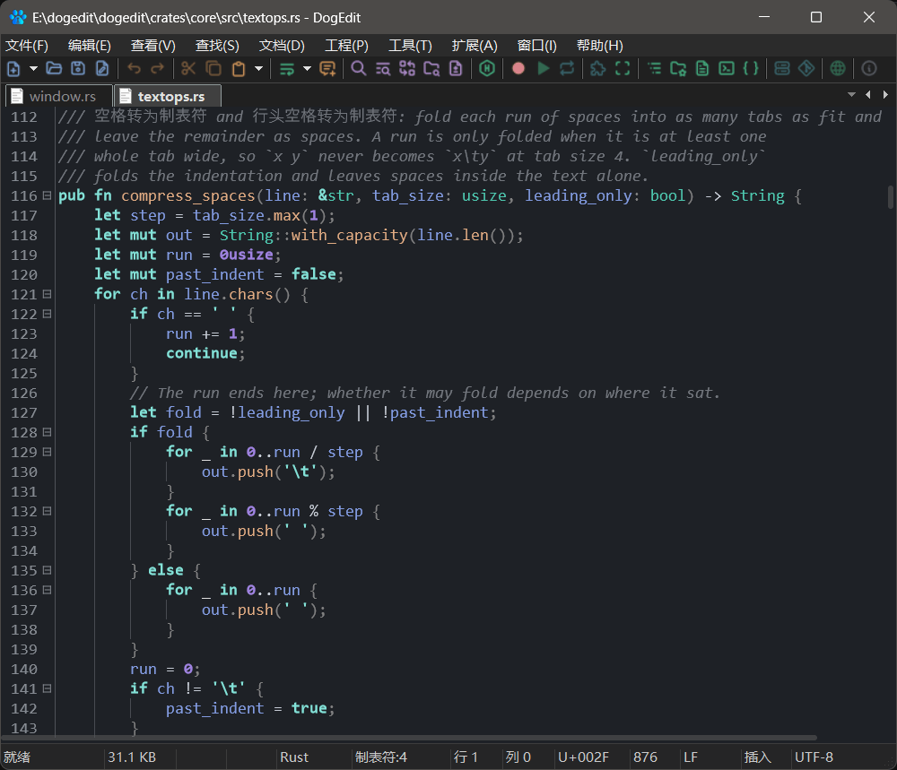
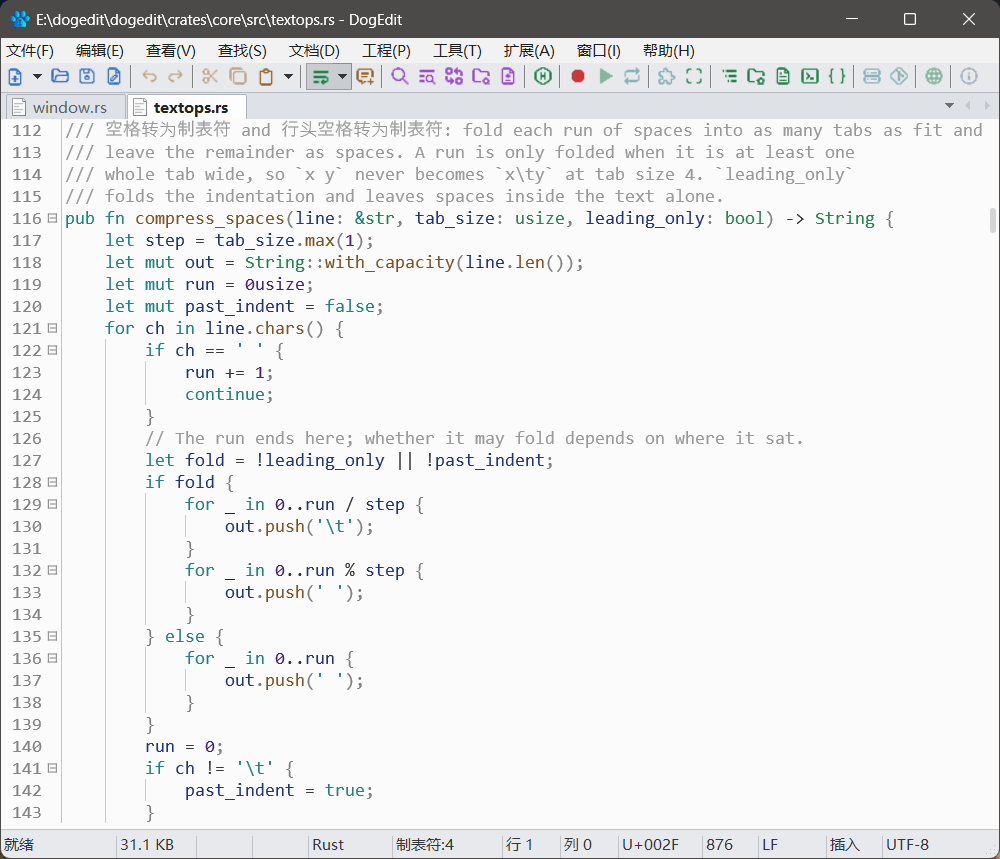

# DogEdit

**简体中文** · [English](README.md)

**用 Rust 写的原生文本编辑器。** 原生，小巧，快速。

**27 套主题 · tree-sitter 增量高亮 · 内置 LSP · Lua 5.4 脚本 · 0 个 Web 运行时**

<p>
  
  
</p>

## 它凭什么不一样

不少编辑器把一整个网页塞进窗口就收工了。DogEdit 反着来：消息循环、菜单、
滚动条、每一个字形都交给系统画。拖一下滚动条，字就跟着走——中间没有
「先启动」这一步。

底下分得也干净：与平台无关的核心管文档、排版、折行、语法、绘制、LSP 和脚本；
原生外壳只负责把核心接到桌面上。**核心甚至不知道「窗口」是什么。**
现在接的是 Windows；将来 Linux、macOS 要的是一层新外壳，不是一只新编辑器。

## 开箱有什么

- **改哪亮哪。** tree-sitter 着色是增量的，折叠和大纲出自同一份解析结果；
  语法解析器做成插件包，在编辑器里按需下载，用什么装什么。
- **语言服务自己接。** 补全、诊断、跳转走标准 LSP，文档位置与 LSP 位置
  的换算精确到行内字符。
- **大文件不心虚。** 行索引按需建立，超大文件模式下按键照样跟手；
  十六进制视图另有一套模型，改字节不会拖住界面。
- **多光标是家常便饭。** 多重选区、列模式、快速选择、书签、宏、跨文件正则
  查找替换——老手的那格抽屉一直敞着。
- **不编译也能改编辑器。** Lua 5.4 脚本包可以加命令、画皮肤、往停靠区放
  面板、往工具栏挂按钮。
- **27 套配色，深浅都有。** 颜色与每个 token 的字形位（粗、斜、下划线、
  删除线、点线、波浪线）都写在 `.ini` 里，改一行、重开就生效。
- **字节不撒谎。** UTF-8、UTF-16、ANSI 自动识别，CRLF 与 LF 原样保留，
  保存时按原来的编码写回，不偷偷改字节。
- **面板随便停。** 查找结果、输出、书签、大纲与文件树都是可停靠的标签组；
  窗口还能拆成多个分组，页签在组间拖来拖去。

## 把狗牵回家

下载[最新发行版](https://github.com/yoyocat/dogedit/releases/latest)：一个便携
zip，不用安装。或者自己编译，只需要 Rust 工具链（1.85+ / edition 2024），
没有 Node，也不用什么 SDK：

```sh
git clone https://github.com/yoyocat/dogedit.git
cd dogedit
cargo build --workspace
cargo run -p dg-app
cargo run -p dg-app -- --selftest   # 不开窗的自检
cargo test --workspace
```

编译产物是 `target/debug/dogedit.exe`。当前版本跑在 Windows 10/11；
Linux 与 macOS 是接下来的目标平台。

想自己拼便携包（`dist/dogedit-<version>-x64.zip` 加一份 `.sha256`）也行。
脚本会把发行版 exe 和它要读的那些数据文件——`setting.ini`、`key.ini`、
`template.ini` 加 `template/`、`lang/`、`themes/`、`packages/` 以及许可文本——
装进同一个目录：

```sh
python tools/make_dist.py                 # 只带数据文件
python tools/make_dist.py --parsers all  # 连 parsers/ 整棵一起打包
```

解析器包默认不带，它们是整包体积的大头，编辑器里可以联网自装。

## 一只编辑器，十三个 crate

| 目录 | 包 | 干什么 |
|---|---|---|
| `crates/app` | `dg-app` | 原生外壳：框架、对话框、输入、停靠、工具栏 |
| `crates/core` | `dg-core` | 文档存储（rope + 行缓存）、选区、撤销、折叠、查找 |
| `crates/layout` | `dg-layout` | 文本度量、折行引擎、纵向行索引 |
| `crates/syntax` | `dg-syntax` | tree-sitter 注册表、增量高亮区间、折叠跨度 |
| `crates/lsp` | `dg-lsp` | LSP 客户端与文档位置换算 |
| `crates/render` | `dg-render` | 绘制管线、主题、小地图、标尺 |
| `crates/ui` | `dg-ui` | 状态栏模型、菜单、滚动条、面板 |
| `crates/skin` | `dg-skin` | 区域、状态、字体与绘制原语的公共词表 |
| `crates/paint` | `dg-paint` | 语法层与绘制层共用的字形位和着色区间 |
| `crates/hex` | `dg-hex` | 十六进制视图模型 |
| `crates/large` | `dg-large` | 大文件行索引 |
| `crates/script` | `dg-script` | Lua 脚本与脚本包 |
| `crates/fixture-json-dll` | `fixture-json-dll` | 仅供测试的解析器夹具 |

目录名去掉了 `dg-` 前缀，包名保留，因为光叫 `core` 会和 Rust 标准库的
crate 撞名。

## 仓库里都放了什么，为什么

不提交任何可执行二进制。随包发布的数据表都能用 `tools/` 里的脚本重新生成：
`make_assets.py`（工具栏、页签条、输出条的精灵图）、`import_icons.py`（图标
图集，MIT）、`make_themes.py`、`make_snippets.py`、`make_templates.py` 与
`make_lang.py`。

`lang/`、`themes/`、`template.ini` 和 `crates/app/snippets/` 是一层兼容面：
已有的 `setting.ini`、`key.ini`、`.lng` 拿过来就能读。其中哪些数据属于本项目
自有，[NOTICE](NOTICE) 写得很清楚。`ctags` 同样不随包发布，可选的符号索引会
在 `PATH` 上找它。

## 文档与设计笔记

- [用户手册](docs/user_manual.html) —— 日常怎么用
- [脚本 API](docs/script_api.html) —— Lua 脚本与脚本包参考
- [项目主页](https://yoyocat.github.io/dogedit/)
- 设计笔记：[Goto Anything](docs/goto_anything_plan.md) ·
  [LLM 集成](docs/llm_plan.md) · [解析器插件](docs/parser_plugin_plan.md) ·
  [原生插件 API](docs/native_plugin_plan.md) ·
  [共享自绘控件](docs/shared_controls_plan.md)

## 群里见

使用上的问题、想要的功能、碰到的 Bug，都欢迎丢过来：
[提 issue](https://github.com/yoyocat/dogedit/issues) 或者加 QQ 群
**1130640365**。

## 许可

MIT。见 [LICENSE](LICENSE) 与 [NOTICE](NOTICE)。
